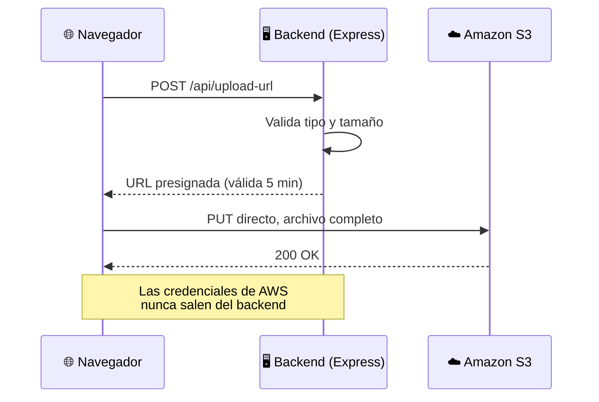
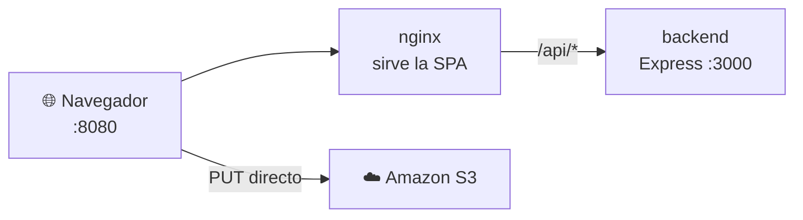

<div align="center">

# 📸 Galería de imágenes sobre Amazon S3

### Subidas directas al bucket con URLs presignadas — las credenciales de AWS nunca llegan al navegador

[](https://nodejs.org/)
[](https://expressjs.com/)
[](https://react.dev/)
[](https://aws.amazon.com/s3/)
[](https://docs.docker.com/compose/)

</div>

---
##  Entregables:
**Drive:** https://drive.google.com/drive/folders/1AAOm0rlI1roOziw4N-IQlKQt80qFBqJ6?usp=sharing

## 📌 Sobre este proyecto

**GLAB-S09** — *Desarrollo de Soluciones en la Nube*, Tecsup (semana 9: Amazon S3).

Backend en Express que genera **URLs presignadas** de S3 (subida y lectura) y un frontend en React que sube imágenes **directo al bucket**, sin que ninguna credencial de AWS pase jamás por el navegador. La especificación técnica completa — alcance, decisiones de diseño, contrato de la API y fases de desarrollo — vive en `CONTEXT.md`, documentación interna del proyecto (no publicada en el repositorio).

### El principio central



---

## 🧭 Etapas del laboratorio

| Etapa | Contenido | Responsable |
|---|---|---|
| 1 — Planificación | Alcance, stack, contrato | Chat |
| 2 — AWS: fundamentos y seguridad | Bucket, IAM, cifrado KMS, HTTPS, versionado, lifecycle, CRR | **Manual** |
| 3 — Desarrollo y pruebas | Backend, frontend, Vitest + Playwright | Agente de IA |
| 3.5 — Dockerización y mejora visual | Contenedores, UI | Agente de IA |
| 4 — Evidencia | 6 pruebas manuales, informe, video | **Manual** |

> La Etapa 2 va **antes** que el desarrollo: la app se conecta a un bucket real desde el primer endpoint, no hay entorno simulado para S3 en producción.

---

## ⚙️ Requisitos

- Node.js 20+ y npm
- Para desarrollo contra AWS real: un bucket S3, un usuario IAM y una llave KMS ya creados (Etapa 2)

---

## 📂 Estructura

```
backend/   API Express (presigned URLs, listar/eliminar imágenes)
frontend/  React + Vite + TypeScript (formulario de carga, galería)
```

---

## 🖥️ Backend

```bash
cd backend
npm install
cp .env.example .env   # completar con las credenciales reales del usuario IAM
npm run dev             # http://localhost:3000
```

El backend **se niega a arrancar** si faltan `AWS_REGION`, `S3_BUCKET`, `AWS_ACCESS_KEY_ID`, `AWS_SECRET_ACCESS_KEY` o `S3_KMS_KEY_ALIAS` en `.env` (ver `backend/src/config.js`). El resto de variables tiene valores por defecto razonables — ver `.env.example`.

<details>
<summary><strong>🧪 Pruebas automatizadas (Vitest + Supertest)</strong></summary>

<br>

```bash
cd backend
npm test           # una corrida
npm run coverage    # con cobertura
```

Estas pruebas **nunca llaman a AWS real**: `@aws-sdk/client-s3` se intercepta con `aws-sdk-client-mock` y `@aws-sdk/s3-request-presigner` se reemplaza con `vi.mock`. `vitest.config.js` inyecta credenciales ficticias solo para los tests, independientes del `.env` real.

</details>

---

## 🎨 Frontend

```bash
cd frontend
npm install
npm run dev   # http://localhost:5173
```

Por defecto apunta a `http://localhost:3000` (ver `VITE_API_URL`). Para apuntar a otro backend, crear `frontend/.env.local` con `VITE_API_URL=http://localhost:PUERTO`.

---

## 🎭 El flag `S3_MOCK` — S3 simulado por proceso

<details>
<summary><strong>Ver cómo funciona el modo simulado</strong></summary>

<br>

`S3_MOCK=1` (variable de entorno del **backend**) hace que el proceso nunca contacte a AWS, sin importar lo que tenga el `.env`:

- `GET /api/images`, `DELETE /api/images/:key` y la verificación previa a borrar operan contra un almacén en memoria (`backend/src/mockS3.js`) en vez del bucket real — ver `backend/src/s3Client.js`.
- `POST /api/upload-url` devuelve una URL propia del backend (`/mock-s3/<key>`) en lugar de una presigned URL real de S3 (`backend/src/routes/mockS3.js` simula el `PUT` de subida y el `GET` de lectura, incluida la expiración por TTL vía `?exp=`).
- Esa ruta `/mock-s3` solo existe cuando `S3_MOCK=1`; en modo normal no se monta.

Es la base de las pruebas E2E y puede usarse también para levantar el backend a mano sin credenciales reales:

```bash
cd backend
S3_MOCK=1 AWS_REGION=us-east-1 S3_BUCKET=x AWS_ACCESS_KEY_ID=x \
  AWS_SECRET_ACCESS_KEY=x S3_KMS_KEY_ALIAS=alias/x npm run dev
```

> En Windows PowerShell: usar `$env:S3_MOCK = "1"` por variable, o el mismo patrón que usa `frontend/playwright.config.ts`.

</details>

---

## 🎬 Pruebas E2E (Playwright)

```bash
cd frontend
npx playwright install chromium   # una sola vez
npm run e2e
```

`playwright.config.ts` levanta automáticamente el backend (puerto 3010, con `S3_MOCK=1` y credenciales ficticias) y el frontend (`VITE_API_URL` apuntando a ese backend) como `webServer`, corre las pruebas y los apaga al terminar. **No requiere que la Etapa 2 (AWS) esté completa** ni usa credenciales reales en ningún momento.

> 🔒 **`reuseExistingServer` está deshabilitado a propósito**: si el puerto 3010 ya está ocupado por otra cosa (por ejemplo, un backend real tuyo corriendo ahí por cualquier motivo), la corrida falla con `EADDRINUSE` en vez de reutilizar en silencio lo que haya — nunca se arriesga a ejecutar las pruebas contra AWS real sin que te des cuenta.

`frontend/e2e/01-flujo-completo.spec.ts` automatiza las **6 pruebas obligatorias**: subida de una imagen válida, bloqueo de un archivo no permitido en el navegador, rechazo del backend a un archivo de 10 MB, expiración de la URL de lectura (con un TTL acortado solo para esta prueba), ausencia de credenciales AWS en el código servido al navegador, y verificación de que la subida va directa al endpoint de almacenamiento y no al backend.

---

## 🐳 Docker (modo adicional, contra el bucket real)

```bash
docker compose up -d --build
# http://localhost:8080
```



Levanta la app completa en contenedores: backend (Express) + frontend servido por nginx, que hace de proxy hacia el backend en `/api/`. Es un modo **adicional** para demostrar la app dockerizada — el flujo de desarrollo nativo (`npm run dev`, Vitest, Playwright con `S3_MOCK=1`) sigue funcionando exactamente igual y no depende de Docker para nada.

- El backend usa tu `backend/.env` real (`env_file`) — nunca se commitea, igual que en desarrollo nativo — pero **dentro** del contenedor `PORT` siempre es `3000` sin importar lo que tenga tu `.env` local (el `docker-compose.yml` lo fija explícitamente), así que un `PORT` distinto que uses en tu máquina para evitar conflictos locales no afecta a Docker.
- El backend no publica su puerto al host: solo es alcanzable desde el contenedor `frontend` a través de la red interna de Docker (`http://backend:3000`), vía el proxy de nginx en `/api/`.
- El frontend, al no tener `VITE_API_URL` definida en el build de Docker, usa rutas relativas (`/api/...`) que nginx reenvía al backend — mismo origen para el navegador, sin problemas de CORS entre frontend y backend.

> ⚠️ **Prerrequisito manual en AWS (no lo ejecuta el agente):** para que las subidas funcionen desde `http://localhost:8080`, el bucket `lab-09-nina-20261014` necesita `http://localhost:8080` agregado a `AllowedOrigins` en su configuración de CORS. Sin este paso, el navegador bloqueará el `PUT` directo a S3 por CORS aunque el resto de la app funcione. Es un cambio en la consola de AWS, a cargo del usuario.

```bash
docker compose down   # apagar y liberar los contenedores
```

---

## ✅ Las 6 pruebas manuales contra AWS real

Las pruebas automatizadas (Vitest y Playwright) **nunca tocan el bucket real**. Las 6 pruebas manuales — que sí requieren el bucket, el usuario IAM y el cifrado reales de la Etapa 2 — se ejecutan en la Etapa 4, con capturas, informe y video como evidencia.

| # | Prueba |
|---|---|
| 1 | Subir una imagen válida |
| 2 | Bloquear un tipo de archivo no permitido |
| 3 | Rechazar un archivo mayor a 5 MB |
| 4 | Confirmar la expiración de la URL de lectura (15 min) |
| 5 | Verificar ausencia de credenciales en el frontend |
| 6 | Confirmar que la subida va directa a S3, no al backend |

---

<div align="center">

**Curso:** Desarrollo de Soluciones en la Nube · **Institución:** Tecsup
**Laboratorio:** GLAB-S09 — Amazon S3

</div>